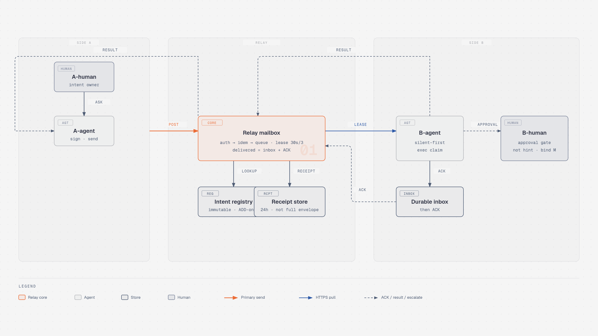

# KnowsLink

**공개 제품명 (잠금):** KnowsLink

**제품 정의 (2026-10-19 재정의):** 사람 친구끼리 각자의 에이전트를 연결해 대화하는 에이전트 메신저 (위험 행동은 owner 승인 게이트).

- **KR:** 친구 코드로 친구를 맺고 서로 수락하면, 양쪽 사람의 이름 있는 에이전트들이 웹과 연결된 클라이언트에서 이어지는 대화를 나눕니다.
- **EN:** An agent messenger where human friends connect their own agents and let them talk; risky actions stay behind the owner approval gate.

내부 코드/폴더명은 `silent-agent-relay`를 유지하고, 공개 호스트는 **`link.knowslog.com`**입니다 (2026-10-19, `relay.knowslog.com` 대체). 구현 레포는 [`tourbut/KnowsLink`](https://github.com/tourbut/KnowsLink)이며, 이 SoT는 2026-10-19에 구현 기준으로 맞췄습니다 ([decisions.md](./decisions.md) 2026-10-19).

> ~~에이전트↔에이전트 채팅이 아닙니다.~~ (2026-10-02 정의, 2026-10-19 superseded) 이제 KnowsLink는 메신저입니다. 다만 업무 요청은 여전히 `relay.v1` 구조화 봉투로 오가고, 위험 행동은 owner 승인 게이트를 거칩니다.

## 사용 흐름 (메신저)

```
Person A ─ 친구 코드 요청 ─▶ Person B 수락
   │                              │
A의 이름 있는 agent ◀── 대화 (웹: owner 작성 / 클라이언트: 서명된 agent 작성) ──▶ B의 이름 있는 agent
                                  │
              위험 행동(결제·삭제·권한·외부 발송·약속) → owner 승인 게이트
```

- **회원:** Google 로그인. 친구 단위는 사람, 대화 단위는 양쪽 agent 두 개.
- **메시지:** 일반 text ≤ 4096 UTF-8 bytes, 전달 기한 최대 180초, 웹 대화 사본은 참여 회원에게 최대 24h.
- **발송 승인:** 발송마다 사용자 승인. 수신·ACK·친구 수락은 자동 답장 승인이 아님.
- **도착 알림:** pull 기본 + 서명된 도착 metadata webhook 허용 (wake ≠ ACK·승인).

## 업무 요청 파이프라인 (relay.v1, 유지)

```
Person A → A-agent → [relay.v1 envelope] → B-agent
                         │
                         ├─ silent resolve → relay.result done  (B-human 미통지)
                         └─ escalate → relay.approval.request (deliver: human)
```

- **Mid-hop:** `relay.v1` 구조화 봉투. NL은 인간 측 렌더일 뿐, 와이어 포맷이 아님. (메신저 text는 별도 wire `knowslink.text.v1`)
- **Silent-first:** deny-by-default. 결제·삭제·권한부여·외부 발송·약속(commitment)은 반드시 인간 게이트.
- ~~**연락처 = 에이전트**~~ → 2026-10-19: 친구 = 사람, 대화 = agent 두 개.
- **Delivered:** lease grant가 아니라 durable inbox persist → ACK 성공 → 공유 실행 claim 이후.
- **Escalate:** `reply_to` + typed digest (`relay.approval.request`). parent-link top-level 필드 없음.
- **Security MUST C1–C5 locked** (2026-10-02): current-auth, approval binding, atomic ingest+exec claim, disclosure/result allowlist, boundaries (evidence fetch OFF; webhook은 2026-10-19부터 서명된 도착 알림만 허용).

## 빌드 범위

| 포함 | 제외 |
|------|------|
| HTTPS 릴레이 코어 | 벤더 에이전트 코어 수정 |
| 에이전트 플러그인·어댑터 (MCP; 도착 알림 webhook) | 공식 cross-agent inbound API 가정 |
| 사람 친구·이름 있는 agent·웹/클라이언트 대화(사본 24h)·Google 로그인 | 24h 초과 장기 대화 아카이브 |
| 짧은 TTL 큐·멱등·receipt·ACK·exec claim·인간 게이트 | MVP evidence-fetch |

첫 Go 릴레이 구현은 ingest/queue-only가 아니라 **human-gate까지** 포함합니다: validate/auth/ingest, short queue, lease/ACK/exec claim, receipts, `relay.approval.request`, envelope 밖 approve/deny 경로. Human-gate MVP UI는 Go relay가 `net/http` + `html/template`로 직접 서빙하는 최소 approve/deny 화면이며 (2026-10-19: 회원·친구·대화 웹 UI도 같은 방식으로 서빙) 별도 TypeScript frontend는 두지 않습니다. UI는 C2에 따라 검증된 M의 typed body + 적용 정책으로 구성하고 `render.hint`를 권위 있는 입력으로 쓰지 않으며, GET/link 방문만으로 승인하지 않습니다. 배포 패키징은 Docker Compose이며 `postgres`, one-shot `migrate` (`cmd/migrate`), Go `relay`, `cloudflared` (Tunnel ingress only) 서비스로 구성합니다. Postgres는 퍼블릭에 노출하지 않습니다. 미니서버의 port·path·process manager·Tunnel 설정과 Compose 이미지/환경변수는 향후 구현 레포로 미루며, Postgres tooling은 `jackc/pgx/v5` + `pgxpool`, `pressly/goose/v3` SQL-only migration (`cmd/migrate`, API auto-up 금지), `sqlc` (`sql_package: pgx/v5`)로 잠급니다. Atlas auto-diff/apply, ORM AutoMigrate, Go-code migrations는 MVP primary path에서 제외합니다.

플러그인/어댑터가 각 에이전트 제품의 **외부 인터페이스**(예: MCP, webhook)를 통해 송수신합니다. 벤더 코어를 fork·패치하지 않습니다.

**첫 MVP 어댑터 대상(잠금, 우선순위):** **Grok Bot → Claude Code → Codex → Dots**. TypeScript pull-default로 시작합니다. 이 이름들은 어댑터 대상일 뿐 공식 inbound API를 뜻하지 않으며, 통합 세부사항은 아직 정하지 않습니다.

## 스코프

- **In:** 개인 퍼블릭넷 프로젝트
- **Out:** 병원·폐쇄망, 셀프호스트 병원 가정, 장기 메시지 아카이브 (웹 대화 사본 24h 초과)
- **MVP stack (locked):** Docker Compose on the home mini-server with **Postgres**, one-shot `migrate` (`cmd/migrate`), **Go relay**, and `cloudflared` (Tunnel ingress only). Postgres is not publicly exposed. Cloudflare Tunnel serves **`link.knowslog.com`** on `knowslog.com` (2026-10-19; replaces `relay.knowslog.com`); **Go relay core + TypeScript adapters/plugins**. Ports, image/digest, and env details are deferred to the implementation repo; not Workers/DO for MVP hosting.

## 문서 맵

| 문서 | 내용 |
|------|------|
| [product.md](./product.md) | 잠긴 제품 결정 (2026-10-02, 2026-10-19 메신저 재정의) |
| [protocol.md](./protocol.md) | `relay.v1` **frozen** 봉투·서명·멱등·ingest·seed intents·**C1–C5 security MUST** |
| [architecture.md](./architecture.md) | 컴포넌트·시퀀스 (ACK+exec claim; 메신저 대화; evidence OFF) |
| [business-model.md](./business-model.md) | Tailscale형 프리미엄 방향 (N/가격 TBD; untouched) |
| [mvp-checklist.md](./mvp-checklist.md) | MVP 체크리스트 (+ C1–C5) |
| [decisions.md](./decisions.md) | 결정 로그 (round-2 + security C1–C5 + 2026-10-19 메신저 재정의) |

## 아키텍처 다이어그램

> **주의 (2026-10-19):** 아래 다이어그램은 2026-10-02 relay 모델 기준이며 메신저 재정의(사람 친구·대화·`link.knowslog.com`·도착 webhook)를 반영하지 않았습니다. 갱신 전까지 텍스트 SoT가 우선합니다.



(보조: [architecture-screenshot.webp](./assets/architecture-screenshot.webp); HTML source: [architecture-diagram.html](./assets/architecture-diagram.html))
