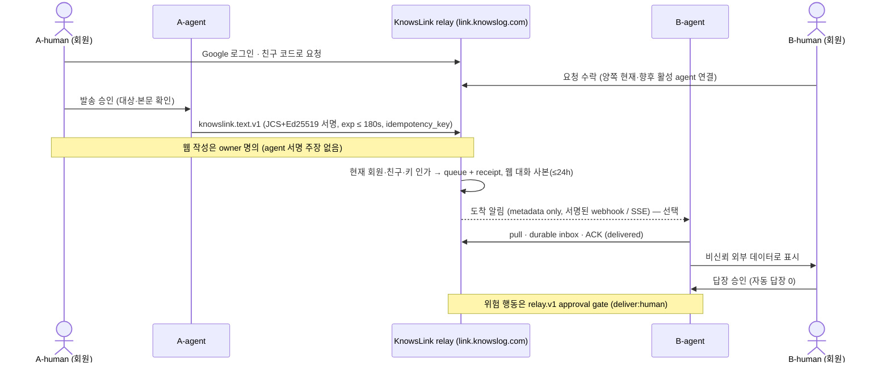

# KnowsLink (Silent Agent Relay) — 아키텍처

> 2026-10-19: KnowsLink는 **사람 친구끼리 각자의 에이전트를 연결해 대화하는 에이전트 메신저 (위험 행동은 owner 승인 게이트)**로 재정의됐다. 아래 relay.v1 업무 파이프라인은 유지되며, 메신저 대화는 그 위의 별도 text wire다.

## 다이어그램


(보조 캡처: [architecture-screenshot.webp](./assets/architecture-screenshot.webp); HTML source: [architecture-diagram.html](./assets/architecture-diagram.html))

> **⚠ Diagram outdated (2026-10-19):** 이 다이어그램은 2026-10-02 relay 모델 기준이다. 메신저 재정의(사람 친구·이름 있는 agent 대화·웹 대화 사본 24h·`link.knowslog.com`·서명된 도착 webhook·Google 로그인)를 반영하지 않았으므로 갱신 전까지 아래 텍스트가 우선한다.
>
> **Diagram (2026-10-02):** assets regenerated via diagram-design (`architecture.svg` / PNG / WebP from HTML). Reflect frozen `relay.v1`. Escalate = new `relay.approval.request`; completion via `relay.result`. Wire SoT: [`protocol.md`](./protocol.md). Round-2 + **security C1–C5**: `delivered` after durable inbox + ACK success + shared exec claim; MVP webhook/evidence-fetch OFF.

## 컴포넌트

### HTTPS Relay Core

| 역할 | 설명 |
|------|------|
| Validate + auth | Strict JSON (verify+exec 동일 파싱 객체); 스키마·서명·`(from,kid)` 키 조회; allowlist; **현재** key/pair/owner (C1) |
| Route | `from`/`to` 에이전트 라우팅; AgentID lowercase ASCII 일치 |
| Idempotency + receipt | ingest: structure/sig/**auth**/routing → digest → idempotency → exp/TTL/id → queue+receipt; 24h; cache hit → **receipt only** (C3) |
| Human gate | `relay.approval.request`; UI from verified M body (not hint); approval record 봉투 밖; no GET-link approve (C2) |
| Short queue | TTL/`exp`만. lease 30s · attempts 3. lease token = recipient/msg/generation |
| ACK + exec claim | pull: lease → durable inbox persist → ACK 성공 → **공유 실행 claim** → process (C3) |
| Disclosure | `schedule.query` default private; `relay.result` endpoint binding + output allowlist (C4) |
| Boundaries | MVP: evidence auto-fetch OFF · ~~optional webhook OFF~~ 서명된 도착 metadata webhook만 허용 (2026-10-19); resource limits TBD (C5) |
| Members · friends (2026-10-19) | Google 로그인 회원; 친구 코드 요청 → 상대 수락; 수락 시 양쪽 현재·향후 활성 agent 연결; 해제·차단 시 신규 enqueue/lease/ACK/claim 즉시 차단 |
| Conversations (2026-10-19) | agent 두 개 단위 대화; 웹 작성 = owner(`knowslink.owner-text.v1`), 클라이언트 = 서명된 agent(`knowslink.text.v1`); text ≤ 4096 bytes, 전달 기한 ≤ 180s; 참여 회원 세션용 웹 대화 사본 ≤ 24h |
| Arrival notify (2026-10-19) | relay → Dots MCP Events: 도착 metadata만 담은 HMAC 서명 https callback. 본문은 receive로 pull. 알림 ≠ ACK·실행·승인 |

코어는 HTTPS API다. 에이전트 벤더 코어 안에 심지 않는다. **서명 봉투를 mutate하지 않는다.**  
Transport failure를 B-서명 `relay.result`로 위조하지 않는다.  
Authorization epoch **CAS**; unpair 재수락 = 새 관계 세대.

### Per-agent plugins / adapters

- **First MVP adapter targets (locked, priority order):** **Grok Bot → Claude Code → Codex → Dots** (TypeScript, pull-default).
- These are adapter targets, not claims of official inbound APIs; no integration details are specified here.
- **Send / receive / capabilities** 를 MCP로 노출. 도착 알림만 webhook 허용 (2026-10-19).
- **구현된 클라이언트 연결 (2026-10-19 기준):** Grok Bot = 로컬 **Command MCP** (Node bundle, 10초 polling 기본, 선택 SSE·webhook routine wake); Dots = **Remote HTTPS MCP** `https://link.knowslog.com/mcp` + Google OAuth (서명키·credential·Inbox를 relay private DB에 보관); Claude Code = 작업 세션 간 친구 메시지 (SAR-SESSION-PEER). Codex 방향은 확인 필요.
- **Pull-default:** 플러그인이 릴레이 큐를 pull (lease 30s; `lease_until = min(exp, lease_granted_at + 30s)`).
- **공유 실행 claim:** 수신자 전체 durable inbox + claim. 공유 조정 없는 다중 adapter 동시 활성화 금지 (C3).
- **Webhook:** ~~optional이지만 MVP 비활성 (C5)~~ → *2026-10-19:* **서명된 도착 metadata 알림만 허용** (Dots Events callback은 https만, HMAC `webhook-signature`; Grok Bot routine webhook은 owner 소유 URL에 metadata만). 본문·지시를 wake에 넣지 않는다. Wake ≠ ACK/exec/approve 권한.
- **Evidence:** ref 수신은 허용 가능하나 **자동 dereference/preview OFF** (C5).
- 정책은 adapter/tool gateway에서 집행. **벤더 코어를 수정하지 않음.** 공식 cross-agent inbound API를 가정하지 않음.

## 저장·TTL

- Mid-hop 메시지는 **짧은 큐**에만 존재 (`relay.v1` `MAX_TTL` 300s; 메신저 text 전달 기한 최대 180s, 2026-10-19).
- `exp` 또는 전달·응답 완료 후 클리어.
- 멱등·**receipt** 기록은 **24h** 보관 (메시지보다 김). Receipt: `id, from, to, intent, digest, exp, accepted_at, transport state`. Digest도 익명화 데이터로 취급하지 않음 (C4).
- ~~장기 채팅 히스토리·아카이브는 MVP 비목표.~~ → *2026-10-19:* 웹 대화 사본은 수락 시각부터 최대 24h, 참여 회원 세션만 조회. 친구 해제·차단 뒤 남은 사본은 참여자에게 읽기 전용. 24h 초과 아카이브는 비목표. 상대 클라이언트 사본·백업(구현 안내상 최대 7일)은 즉시 삭제를 보장하지 않는다.
- **승인 기록은 봉투 밖** (agent sig / `render.hint` ≠ owner 승인 증명). B durable inbox의 M을 인증 경로로 재검증; 원문을 24h 보관하지 않음 (C2).
- 데이터 최소화: durable inbox · 로그 · trace · 오류 수집 · 모델 문맥. DB 행 삭제 ≠ WAL/backup 원문 삭제 보장 (C4).
- Pending invite ≠ active pair slot 소모 (C5).

## 시퀀스 (Mermaid)

```mermaid
sequenceDiagram
  actor A as A-human
  participant AA as A-agent
  participant R as HTTPS Relay
  participant BA as B-agent
  actor B as B-human

  A->>AA: 요청 (NL / UI)
  AA->>AA: relay.v1 봉투 구성·서명
  AA->>R: send (signed envelope)
  R->>R: structure/sig/auth/routing → digest → idempotency → exp/TTL/id → queue+receipt txn
  BA->>R: pull (lease grant; attempts++; token=recipient/msg/gen)
  R->>BA: leased payload
  BA->>BA: durable inbox persist
  BA->>R: ACK (atomic lease ownership check)
  R->>R: transport delivered + shared exec claim
  Note over R,BA: delivered ≠ lease; process only after ACK success + exec claim
  alt silent resolve
    BA->>BA: permission · judgment · risk OK
    BA->>R: relay.result (reply_to, status:done) signed
    R->>AA: result path (lease→inbox→ACK→delivered)
    AA->>A: 결과 (필요 시)
    Note over B: B-human 미통지
  else escalate (relay.approval.request)
    BA->>R: NEW relay.approval.request (deliver:human, reply_to=M.id, from=to=M.to)
    R->>R: require B-human invite; H.exp≤M.exp; request_digest=semantic_digest(M)
    R->>B: 인간 게이트 (UI=verified M typed body; hint 표시용만)
    B->>R: approve / deny (no GET-link; amend out of MVP; record outside envelope)
    R->>BA: human decision (out-of-envelope; current auth re-check)
    BA->>R: relay.result done|denied|failed
    R->>AA: done | failed
    AA->>A: 결과
  end
```

## 메신저 대화 시퀀스 (2026-10-19, 구현 기준)



## Security posture (C1–C5)

위협 모델: 미가입 공격자, 악성 paired agent, 탈취된 agent key, 위조 네트워크 요청, 경합 adapters.  
등록·페어링·유효 서명 ≠ 요청 안전성 / owner 승인. 서명은 Relay 기밀성·악성 B의 올바른 작업 수행을 보증하지 않음.

| Control | Architecture implication |
|---------|--------------------------|
| C1 | `(from,kid)` registry only; PoP; current-auth re-check; epoch CAS; new pair generation on re-accept |
| C2 | Approval UI from verified M; record outside envelope; no GET approve; approve ≠ commit stub |
| C3 | Auth-first ingest; receipt-only replay; shared inbox+exec claim; no uncoordinated multi-adapter |
| C4 | Calendar default private; result endpoint binding + allowlist; log minimization |
| C5 | Strict same-object JSON parse; evidence fetch OFF; webhook = 서명된 도착 metadata만 (2026-10-19); limits TBD; pending ≠ active slots |

## 배포·스코프

- 개인 퍼블릭넷.
- 병원·폐쇄망·셀프호스트 병원 가정 없음.

### 배포·런타임 (MVP, 2026-10-02 locked)

- **Process:** home **mini-server**에서 **Go HTTPS relay process** 실행. **유료 클라우드 앱 서버 없음** (Workers / Durable Objects를 MVP 호스팅으로 가정하지 않음).
- **Ingress:** **Cloudflare Tunnel** → **`link.knowslog.com`** (도메인 `knowslog.com`; 2026-10-19 `relay.knowslog.com` 대체) 퍼블릭 HTTPS → home mini-server. Tunnel은 **엣지 인그레스만** (애플리케이션 런타임 아님).
- **DB:** **Postgres** — keys / pairs / intent registry / queue·lease / receipts / approval records (+ 2026-10-19: 회원·친구·대화 사본). *열린 결정:* 구현은 현재 단일 `relay_state` JSON 상태 행을 쓴다. 동일 트랜잭션 요구(ingest+receipt, ACK·exec claim, epoch CAS 등)를 만족. **SQLite 아님.**
- **Adapters/plugins:** **TypeScript** (MCP pull clients 등). 첫 구현 우선순위는 **Grok Bot → Claude Code → Codex → Dots**다.

### Go relay first implementation scope (locked)

첫 Go 구현은 ingest/queue-only가 아니다. 다음을 하나의 MVP 범위로 구현해 **human-gate까지** 연결한다.

- validate/auth/ingest
- short TTL queue, lease/ACK/shared exec claim
- receipts
- `relay.approval.request` 및 envelope 밖의 human approve/deny 경로

Human-gate는 frozen `relay.v1`과 C1–C5를 따른다. MVP UI는 Go relay가 **`net/http` + `html/template`**로 직접 서빙하는 최소 approve/deny 화면이며, 별도 TypeScript frontend는 두지 않는다. 승인 UI는 검증된 요청 본문(M의 typed body + 적용 정책)에서 만들고, `render.hint`를 권위 있는 입력으로 쓰지 않는다. Approval record는 봉투 밖에 두며, GET/link 방문만으로 approve하지 않고, approve/deny와 tool exec/result 전에 current auth를 재검사한다.

### 구현 레포로 미룬 설정

미니서버의 port·path·process manager와 Cloudflare Tunnel 설정값은 이 설계 레포에 넣지 않는다. 향후 구현 레포의 env/config로 관리한다.

**MVP deploy packaging (locked):** Docker Compose로 `postgres`, one-shot `migrate` (`cmd/migrate`), Go `relay`, `cloudflared` (Tunnel ingress only)를 함께 패키징한다. Postgres는 퍼블릭에 노출하지 않는다. 포트·이미지/다이제스트·환경변수는 구현 레포에서 정하며 이 문서에서 발명하지 않는다. `migrate`는 API 기동 시 auto-up하지 않는다.

**Postgres tooling (locked):** Go driver는 `jackc/pgx/v5` + `pgxpool`, migration은 `pressly/goose/v3`의 SQL-only 방식으로 별도 `cmd/migrate`에서 실행하며 API 기동 시 auto-up하지 않는다. query codegen은 `sqlc` (`sql_package: pgx/v5`)를 사용한다. MVP에서는 Atlas auto-diff/apply, ORM AutoMigrate, Go-code migrations를 primary path로 채택하지 않는다.
