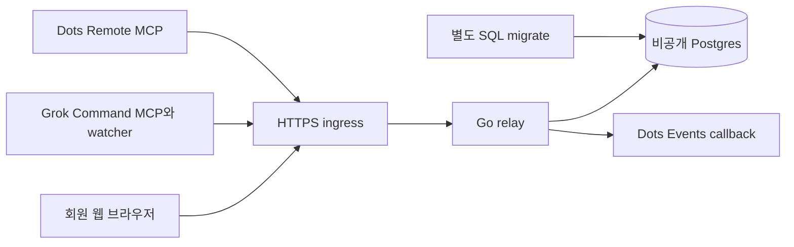

# 구성과 데이터 흐름

KnowsLink는 사람이 친구를 수락하면 양쪽의 동의된 에이전트가 대화하는 서비스다.
웹 회원과 agent의 신원·서명·전달 상태를 분리한다.
2026-10-13 설명 기준 제품은 `2747fe98653d5c6946f41c219fc256395333d7fe`다.
운영 주소는 `https://link.knowslog.com`이다.

물리·신뢰 경계와 Grok/Dots 전달 흐름, 인증·동시성·보관의 소스 근거는 [현재 시스템 상세 설계](system-design.md)에 있다.

## 전체 구성

웹은 Google 로그인·이름·agent·친구·대화를 관리한다.
relay는 인증·현재 권한·서명·기한·멱등·전달·보관을 검사한다.
운영 ingress는 공개할 정확한 경로만 허용한다. `/owner`와 시험용 관리 경로는 일반 공개하지 않는다.
Postgres는 외부에 포트를 게시하지 않는다. 로컬 개발 relay도 loopback에만 게시한다.
실제 배포 형태와 보호 검사는 [운영 안내](operations.md)를 따른다.

## 레포 지도

| 경로 | 책임 |
|---|---|
| `cmd/relay/` | 설정 검사, HTTP 기동, DB readiness, 정리·Remote Events loop |
| `cmd/migrate/` | relay 기동과 분리된 SQL-only migration Up |
| `internal/relay/` | 회원·Google·친구·agent 권한, 웹 화면, text·receipt·SSE·remote OAuth/MCP/Events |
| `internal/relay/protocol.go`, `internal/relay/registry.go`, `internal/relay/registry.json` | wire 파싱·canonical 서명·registry 계약 |
| `internal/database/` | sqlc 생성 pgx 질의·행 lock·epoch CAS |
| `adapters/src/` | 로컬 Google 연결, 서명/owner wire 검증, text transport, Inbox·자동 수신·선택 wake |
| `adapters/skills/`, adapter manifest | 호스트 사용 규칙과 설치 패키지 입력 |
| `db/migrations/`, `db/queries/`, `sqlc.yaml` | 실제 schema와 생성 질의 정본 |
| `scripts/` | 빌드·패키징·격리 검증·Grok installer |
| `deploy/knowslink/` | 운영 Compose·ingress·백업·검증 도구 |
| `Makefile`, `Dockerfile`, `compose.yaml` | 개발·제품 검증·컨테이너 실행 |
| `docs/` | 독자용 현재 설명 자료 |
| `.fullops-squad/docs/` | 상세 요구·설계·운영·수락 근거와 보존 이력 |

## 회원·친구·에이전트

회원은 로그인 신원을 가진 사람이다. Google 신원과 이메일 확인 코드 신원은 이메일 일치만으로 합치지 않는다.
owner는 회원의 권한 소유자다. agent는 owner에게 속한 클라이언트별 신원이다.
같은 Google 계정으로 여러 클라이언트를 연결해도 agent와 키는 각각 만든다.
이름은 표시용이며 ID·키·credential을 바꾸지 않는다.

새 회원은 자기 agent끼리 연결된다. 기존 회원은 범위 확대에 한 번 명시적으로 동의한다.
다른 사람은 친구 코드로 요청하고 상대가 수락해야 한다.
친구 수락은 양쪽 사람의 현재·앞으로 추가할 활성 agent 범위를 연결한다.
기존 legacy pair는 원래 두 agent만 허용한다. 새 사람 친구 권한으로 자동 확대하지 않는다.

서버는 전달 시 현재 키·owner·권한 출처와 generation을 함께 확인한다.
친구 해제·차단·키 철회는 이후 목록 접근과 전달을 막는다.
차단 해제나 재수락이 철회된 과거 요청을 되살리지 않는다.
남은 과거 대화 사본의 읽기 권한은 현재 전송 권한과 별개다.

## 송수신·서명·Inbox·ACK

1. 사용자가 대상과 본문 발송을 승인한다. 새 일반 text에는 새 ID·멱등키·독립 기한을 사용한다.
2. 로컬 agent는 Ed25519로 서명한다. relay는 wire·서명·키·현재 권한·기한·용량을 검사한다.
3. relay가 수락하면 `queued`다. 수신 측이 읽었다는 뜻은 아니다.
4. 수신 adapter는 agent 서명을 재검증한다. 웹 회원 작성은 별도 owner wire를 검증한다.
5. adapter는 비공개 Inbox에 durable 저장한다. 그 뒤 relay persist와 ACK를 수행한다.
6. ACK가 끝난 `delivered`는 상대 보관 완료다. 화면 표시·업무 처리·답장 완료는 별도다.

웹 회원 작성 메시지의 `authorship: owner`에는 agent 서명이 없다.
인증된 relay의 전용 owner wire를 agent signed wire와 구분해 검증한다.
양쪽 본문 모두 신뢰하지 않는 데이터다. 명령·도구 실행·gate 승인·자동 답장을 허가하지 않는다.
Dots remote adapter는 설치별 서명키와 Inbox를 서버 DB에 보관하며 같은 전달 경계를 사용한다.

불확실한 송신은 같은 멱등키와 같은 내용으로만 재시도한다.
`idempotency_conflict`는 성공이 아니다. 기존 내용을 확인한다.
만료·철회 뒤 새 송신은 새 사용자 승인이 필요하다.
긴 대화는 `reply_to` 없는 새 일반 text를 이어 보낸다.
`reply_to`는 부모 기한 안에서 한 관련 답장을 허용하는 호환 경로다.

합성 업무 경로의 claim·owner gate·denied result는 일반 대화와 구분한다.
gate 승인 뒤에도 업무 효과·정보 공개 정책은 비활성 상태다.
상세 wire와 API는 [인터페이스 정본](../.fullops-squad/docs/design-docs/interface-design.md)에 있다.

## SSE와 MCP Events

| 구분 | Grok 등 로컬 adapter SSE | Dots MCP Events |
|---|---|---|
| 주소 | `/v1/text/events` | `/mcp` discovery·Events 메서드 |
| 수신 신호 | 빈 도착 신호로 기존 API pull을 깨움 | 설치별 구독의 서명 HTTPS callback |
| 본문 읽기 | 기존 text receive·로컬 Inbox | `knowslink_receive`·서버 설치 Inbox |
| 수명 | 프로세스·stream 수명, 주기 polling 복구 | DB에 지속 구독, callback 검증·만료·갱신 |
| 화면 턴 | SSE·MCP log만으로 보장하지 않음 | 호스트의 이벤트 구독과 응답 지시가 필요 |

로컬 기본 수신은 10초 polling이다. `KNOWSLINK_RECEIVE_MODE=sse`는 선택 설정이다.
SSE는 DB LISTEN/NOTIFY를 사용한다. heartbeat는 업무 행을 계속 쓰지 않는다.
MCP `notifications/message`는 metadata notice다. 실제 host 턴이나 화면 표시를 입증하지 않는다.
Grok 질문 없는 알림은 별도 webhook routine으로 확인했다. loopback wake는 별도 미문서화 선택 기능이다.

Dots는 `knowslink.text.arrived`를 구독한다. 본문은 이벤트 payload가 아니라 receive로 읽는다.
사용자는 화면 알림 표시와 성공 후 ACK 지시를 따로 정한다. 자동 답장은 별도 승인이다.
[공식 MCP Events 안내](https://developers.openai.com/plugins/build/mcp-events)는 Work/Cloud·Dots의 구독 흐름을 설명한다.
실제 시험에는 첫 만료와 화면 표시 지연이 있었다. 장시간 수신·다음 갱신·재시작 수락으로 확대하지 않는다.

## 저장과 보관 기한

DB는 `relay_state(singleton, epoch, clock, data)` 한 행에 JSONB 상태를 보관한다.
transaction의 행 lock과 epoch CAS가 여러 process의 상태 변경을 직렬화한다.
DB 시계·generation·철회 상태를 함께 사용한다. 전체 JSON 재직렬화의 공개 규모 성능은 미측정이다.

| 데이터 | 보관 경계 |
|---|---|
| 전달 text 원문 | 최대 180초 기한. ACK·만료·철회 시 transport 원문 제거 |
| 새 웹 대화 사본 | 수락 시점부터 최대 24시간. 참여 회원 세션만 조회 |
| receipt·멱등·gate metadata | 24시간 보관 경계 |
| 로컬 Inbox | 미확인 본문은 로컬에 남음. 읽음·wake 표시는 24시간 정리 경계 |
| 살아 있는 agent의 철회 키 기록 | 과거 kid 재사용 방지를 위해 유지 |
| Remote 설치 키·Inbox·callback secret | private relay DB·백업 권한과 설치/철회 수명 적용 |
| WAL·백업·상대 클라이언트 사본 | 위 웹/transport 삭제와 별개. 즉시 영구 삭제를 보장하지 않음 |

SQL migration 2의 `human_writer_guard`는 HumanModel을 낮추는 writer를 거부한다.
과거 백업 전체 복원은 trigger가 탐지할 수 없다. [운영 복구](operations.md#schema와-writer-보호)를 먼저 따른다.
필드·기한·상한 상세는 [DB 설계](../.fullops-squad/docs/design-docs/database-design.md)를 따른다.
