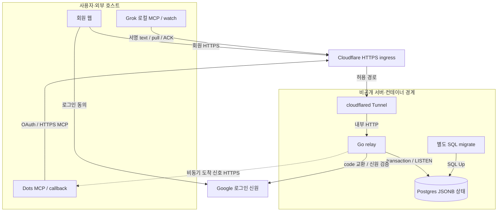
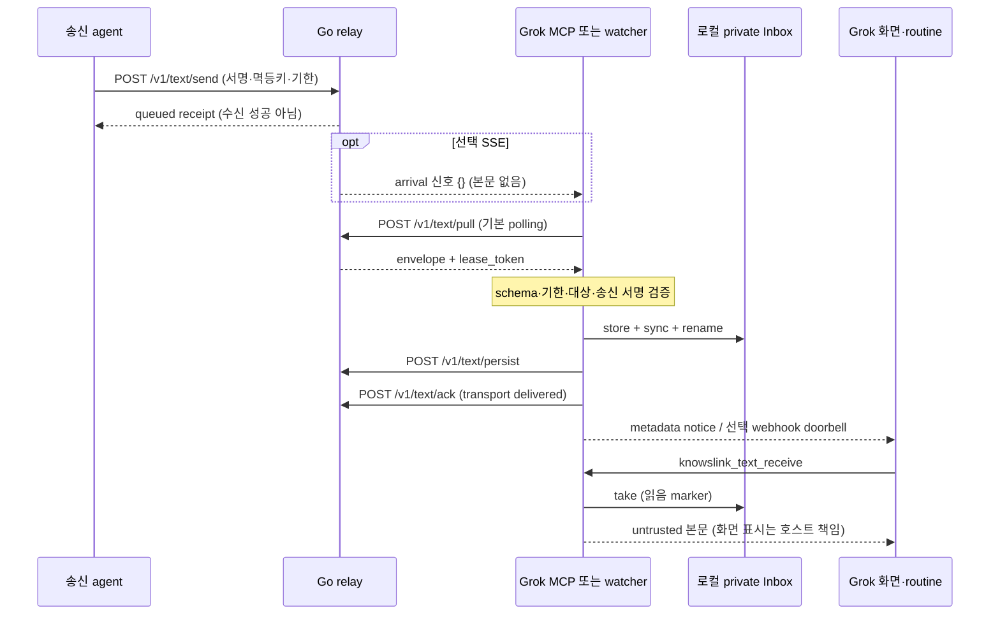
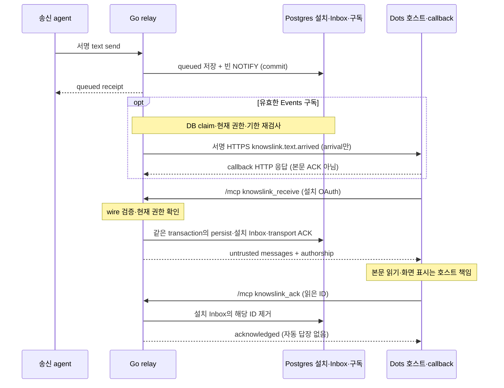

# 현재 시스템 상세 설계

KnowsLink는 사람이 수락한 관계 안에서 여러 에이전트의 일반 text를 전달한다.
웹 회원, 권한 소유자(owner), 에이전트(agent), 클라이언트 설치는 서로 다른 경계다.
이 문서는 구현을 설명한다. 설치 절차는 [README](../README.md), 입문 지도는 [구성 안내](architecture.md)를 따른다.

2026-10-14 SAR-REFACTOR-002는 아래 보관·Inbox·Events 처리 비용과 실패 복구를 보완했다.
소스·검증 후보는 [DEV 보고](../.fullops-squad/docs/evaluations/qa-reports/SAR-REFACTOR-002-DEV/report.md)에 고정한다. 아래 운영 관측 날짜를 갱신한 배포 결과는 아니다.

## 기준과 확인 범위

문서의 소스 기준은 `8f255f9991787e14b38052029d334b9536160fdb`다.
마지막 운영 관측은 2026-10-13의 제품 `2747fe98653d5c6946f41c219fc256395333d7fe`다.
문서 기준 커밋과 운영 제품 커밋을 같은 것으로 해석하지 않는다.
[운영 적용 기록](../.fullops-squad/docs/evaluations/qa-reports/SAR-REFACTOR-001-OPS/report.md)은 서비스 health·보존·백업·격리 복원·공개 경로 검사를 기록한다.
이번 문서 작업은 운영 서비스나 실계정의 상태를 다시 확인하지 않았다.

실제 두 계정의 대화와 질문 없는 화면 알림은 직전 제품 `26094e9`의 별도 관측이다.
[대화 기록](../.fullops-squad/docs/evaluations/qa-reports/SAR-HUMAN-PEER-002-LIVE/report.md)과 [알림 기록](../.fullops-squad/docs/evaluations/qa-reports/SAR-HUMAN-PEER-003-NOTIFY/report.md)을 그 범위로 읽는다.
새 계정·장시간 수신·다음 구독 갱신·호스트 재시작·공개 규모 성능의 성공은 확인하지 않았다.

## 전체 구성과 신뢰 경계

실선은 논리 요청 경로다. 일반 응답은 생략했다. 점선은 본문 없는 비동기 callback이다.
cloudflared는 Cloudflare 쪽으로 outbound Tunnel 연결을 먼저 유지한다. 화살표는 물리 연결 개시 방향을 뜻하지 않는다.
Google의 브라우저 callback은 공개 ingress를 통해 relay로 돌아온다.
그림의 Dots 상자는 외부 호스트의 MCP 호출자와 Events 수신 역할을 묶는다. 하나의 프로세스라는 뜻은 아니다.
선택 SMTP와 Grok webhook routine은 아래 표와 전달 절에서 설명한다. 그림에는 별도 노드를 추가하지 않았다.
그림의 서버 묶음은 물리 배치 경계다. relay 내부 모듈을 독립 서비스로 표시하지 않는다.
Cloudflare와 cloudflared는 별도 구성요소다. Tunnel은 DB에 직접 접속하지 않는다.

| 구성요소·소스 | 프로토콜·책임 | 저장 위치·권한 경계 |
|---|---|---|
| 회원 웹: [human_http.go](../internal/relay/human_http.go), [member_pages.go](../internal/relay/member_pages.go) | HTTPS 세션·폼으로 이름·agent·친구·대화 관리 | 회원·세션·웹 사본은 relay DB. 브라우저 로그인은 agent 서명이 아님 |
| Grok: [mcp.ts](../adapters/src/mcp.ts), [text.ts](../adapters/src/text.ts) | 로컬 stdio Command MCP, HTTPS text transport, 별도 watch 실행 가능 | 연결 폴더의 개인키·agent 자격·private Inbox. MCP stdout은 프로토콜 전용 |
| Dots: [remote_mcp.go](../internal/relay/remote_mcp.go), [remote_auth.go](../internal/relay/remote_auth.go) | `/mcp` JSON-RPC와 설치별 OAuth 권한. 서버가 설치 키로 서명 | 설치별 개인키·Inbox는 private relay DB. 로컬 Grok 폴더와 다름 |
| 공개 ingress: [public-ingress.yml](../deploy/knowslink/tunnel/public-ingress.yml) | 정확한 hostname·경로만 relay에 전달 | 이 fragment는 edge Access 정책 자체를 변경하지 않음 |
| Tunnel: [compose.yaml](../compose.yaml), [compose.ops.yaml](../deploy/knowslink/compose.ops.yaml) | cloudflared가 외부 Tunnel과 내부 relay HTTP를 연결 | 운영 Tunnel 설정은 읽기 전용 mount. ingress network에만 연결 |
| relay: [main.go](../cmd/relay/main.go), [http.go](../internal/relay/http.go) | 인증·권한·서명·기한·멱등·전달·화면, Cleanup·RemoteEvents loop | Postgres pool과 JSONB 상태. 업무 효과·자동 답장 엔진은 아님 |
| DB: [store.go](../internal/relay/store.go), [relay.sql](../db/queries/relay.sql) | singleton 행 lock·epoch CAS·DB 시계·LISTEN/NOTIFY | 비공개 Postgres volume. DB 호스트 포트 게시 없음 |
| migration: [main.go](../cmd/migrate/main.go), [SQL](../db/migrations/00002_human_writer.sql) | 별도 프로세스가 SQL-only Up 수행 | schema·goose version·writer trigger. relay 기동과 분리 |
| Google: [google.go](../internal/relay/google.go) | OIDC code 교환·ID token 검증·회원 신원 연결 | Google 비밀 설정은 서버 환경. Google token을 Remote 설치에 저장하지 않음 |
| 선택 SMTP: [mail.go](../internal/relay/mail.go), [main.go](../cmd/relay/main.go) | 설정 시 이메일 확인 코드 발송. 일반 메시지 알림 경로가 아님 | 서버 SMTP 설정과 DB의 확인 challenge. 미설정 시 이메일 로그인 비활성 |
| 선택 알림: [grok-wake.ts](../adapters/src/grok-wake.ts), [remote_events.go](../internal/relay/remote_events.go) | Grok routine doorbell 또는 Dots 서명 callback | Grok secret 파일은 로컬 private. Dots subscription·secret은 relay DB |

Go는 `net/http`·`html/template`로 웹과 API를 함께 제공한다. 별도 React 서버나 프런트엔드 서비스는 없다.
별도 queue broker·Redis·microservice는 없다. 전달 대기 상태도 같은 Postgres JSONB에 있다.

## 회원·owner·agent·관계

회원은 로그인 신원과 화면을 사용하는 사람이다. owner는 그 회원의 권한 소유 단위다.
agent는 owner에게 속한 송수신 endpoint다. 키와 credential은 agent의 접속·서명 수단이다.
같은 Google 계정으로 여러 클라이언트를 연결해도 agent·키·설치는 각각 만든다.
사람 이름과 agent 이름은 표시값이다. 이름 변경은 ID·키·credential 변경이 아니다.

| 관계 | 수락·적용 범위 | 전달 시 검사 |
|---|---|---|
| 자기 agent | 새 회원은 자기 연결을 사용. 기존 회원은 `SelfConnect` 확대에 명시 동의 | 같은 회원의 서로 다른 활성 agent, `self:` 출처 |
| 사람 친구 | 친구 코드 요청을 상대 사람이 수락. 현재와 앞으로 추가할 활성 agent에 적용 | `friend:` 출처, 관계 generation, 차단·owner·키의 현재 상태 |
| legacy pair | 원래 두 agent의 개별 수락만 유지 | 정확한 agent 쌍과 원래 generation. 사람 친구로 자동 확대하지 않음 |

[human.go](../internal/relay/human.go)의 `authority`는 서로 구분되는 출처와 generation을 반환한다.
[store.go](../internal/relay/store.go)의 `current`는 저장된 출처·generation과 현재 권한을 다시 대조한다.
수신 agent에는 활성 키가 있어야 한다. agent·owner·송신키 철회도 전달을 막는다.
친구 해제·차단은 이전 권한의 재사용을 차단한다. suppression은 legacy pair의 우회 사용도 막는다.
차단 해제나 새 친구 수락은 과거 송신·lease·gate를 되살리지 않는다.
남은 웹 사본의 참여자 열람은 현재 전송 권한과 별도다.

## 인증·서명·입력 경계

웹 회원 경로는 세션과 서버의 owner 소유 검사를 사용한다. 상태 변경에는 폼·출처 보호를 적용한다.
agent API는 bearer credential을 agent·키에 연결한다. 인증 성공만으로 상대 전송 권한이 생기지 않는다.
서버는 매 전달 단계에서 현재 친구/자기/legacy 권한을 확인한다.
[연결 처리](../internal/relay/connections.go)는 grant·새 키의 소유 증명·owner 확인·한 번의 완료를 구분한다.

Google 로그인은 issuer와 subject를 신원으로 사용한다. 이메일 문자열이 같다는 이유로 이메일 코드 회원과 합치지 않는다.
[google.go](../internal/relay/google.go)는 state cookie·한 번만 쓰는 시도·nonce·PKCE와 검증된 ID token을 연결한다.
issuer·audience·서명과 이메일 확인·token 발급 시점을 검증한다. Google 로그인은 받은 text 실행 동의가 아니다.
설정이 모두 없으면 Google 로그인은 꺼진다. 일부 설정만 있거나 안전하지 않은 callback이면 기동을 거부한다.

Dots는 relay 자체의 Remote OAuth를 사용한다. Google 로그인 뒤 사용자가 설치 생성을 명시적으로 승인한다.
[remote_auth.go](../internal/relay/remote_auth.go)는 PKCE `S256`, 등록된 redirect, resource `/mcp`, scope `knowslink.text`를 묶는다.
code는 한 번 사용한다. access token은 1시간이며 refresh는 회전한다. 설치 수명은 30일이며 token 교환 시 갱신한다.
설치 권한 검사에는 owner·agent·현재 키·설치 만료가 포함된다. Remote token을 일반 `/v1` credential로 사용하지 않는다.
서버 보관 개인키와 callback secret 때문에 DB와 백업 접근자는 신뢰 경계 안에 있다.
서명은 종단 간 암호화를 뜻하지 않는다. relay는 본문을 읽고 웹 사본을 만들 수 있다.

agent wire `knowslink.text.v1`은 Ed25519로 서명한다.
서명 입력은 domain prefix·version·algorithm·kid와 canonical 필드다. [Go wire](../internal/relay/public_text.go)와 [TS wire](../adapters/src/text.ts)가 대응한다.
수신 측은 허용 schema·ID·대상·기한을 검사하고 송신 public key로 서명을 재검증한다.
웹 작성은 `knowslink.owner-text.v1`과 `authorship: owner`를 사용한다. agent 서명을 꾸며 넣지 않는다.
owner wire는 인증된 relay 수신 경로와 서버의 세션·소유·권한 검사를 신뢰한다.
서명 유효 여부와 관계없이 본문은 `untrusted` 데이터다. 본문은 도구 실행·gate 승인·자동 답장 권한이 아니다.

## Grok 로컬 전달과 수신

다음 그림은 송신 agent가 Grok 수신 agent에 일반 text를 보내는 성공 경로다.
그림의 송신자는 로컬 agent API 경로다. Dots 송신은 `/mcp`의 `knowslink_send`가 같은 text 수락 처리를 호출한다.
웹 owner wire의 차이는 앞 절을 따른다.

sequence의 점선은 응답 또는 알림이다. 비동기 여부는 단계 이름과 `opt`로 구분한다.
DB transaction과 키 조회 응답, persist/ACK HTTP 응답은 가독성을 위해 생략했다.
`MCP 또는 watcher`는 수신 역할이다. 두 프로세스가 하나라는 뜻은 아니다.
수신 process 하나의 자동·수동 pull은 [inbox.ts](../adapters/src/inbox.ts)의 `serial`로 직렬화한다.
MCP와 watcher 사이에서는 파일의 exclusive 생성·rename·ID marker로 중복 표시와 wake를 제한한다.

기본 자동 수신은 10초 polling이다. `KNOWSLINK_RECEIVE_MODE=sse`는 선택 설정이다.
[text_events.go](../internal/relay/text_events.go)는 인증된 `/v1/text/events`에서 `ready`·`arrival`의 빈 payload만 보낸다.
SSE는 본문·송신자·멱등키를 전달하지 않는다. 신호 뒤 기존 pull API로 본문을 받는다.
LISTEN을 먼저 열고 현재 상태를 읽어 연결 직전 도착을 놓치지 않게 한다.
55초 stream 수명과 15초 heartbeat를 사용한다. heartbeat 때 업무 행을 polling하거나 계속 쓰지 않는다.
adapter는 재연결과 polling 복구를 유지한다. 신호 성공만으로 전달·표시를 보장하지 않는다.

Inbox는 임시 파일에 기록하고 `sync` 뒤 rename한다. 저장이 실패하면 transport persist/ACK를 진행하지 않는다.
같은 ID가 이미 저장됐거나 읽음 marker가 있으면 중복 저장·재알림을 막는다.
ACK 응답 유실이나 lease 재발급은 본문을 다시 표시하라는 뜻이 아니다.
`take`는 가장 오래된 로컬 본문을 읽음 marker로 바꾼다. 반환의 `expired: true`는 관련 답장 기한 종료를 뜻한다.
unread 후보가 있으면 housekeeping을 claim 전에 마친다. 정리 오류가 나면 unread 본문을 보존하고 실패를 반환한다.
동시 receiver가 없앤 임시 파일·marker의 stat ENOENT만 건너뛴다. claim 후 process crash·본문 read/write 실패 복구를 보장하지 않는다.

MCP `notifications/message`는 metadata notice다. `sent_unverified`는 호스트의 새 턴·표시 완료가 아니다.
선택 Grok webhook routine은 고정 doorbell과 검증된 ID만 보낸다. 받은 본문을 권한 있는 prompt에 넣지 않는다.
`accepted_unverified`는 HTTP 수락만 뜻한다. routine 실행·화면 표시·답장은 각각 별도다.
[grok-wake.ts](../adapters/src/grok-wake.ts)는 webhook과 선택 loopback wake를 배타적으로 사용한다. 실패 시 두 방식으로 중복 발송하지 않는다.

## Dots 원격 전달과 Events

다음 그림은 유효한 설치와 Events 구독이 있는 Dots의 수신 경로다.
구독은 필수 전제가 있는 선택 알림이다. 도착 event 자체에 본문은 없다.

[remote_mcp.go](../internal/relay/remote_mcp.go)는 설치별 서버 키로 송신 wire를 만든다.
수신에서는 agent 서명을 재검증한다. owner wire는 현재 message·authorship·대상·권한을 검사한다.
서버는 같은 transaction에서 transport persist, 설치 Inbox 보관, transport ACK를 수행한다.
응답 유실 시 Inbox 사본을 다시 반환할 수 있다. 호스트의 `knowslink_ack`는 별도 Inbox 읽음 처리다.
이 Inbox는 무기한 오프라인 보관함이 아니다. 만료·철회·현재 권한 상실 시 sweep이 사본을 제거한다.
설치 Inbox가 32개면 새 lease를 가져오지 않는다. 보관된 유효 사본부터 읽고 ACK한다.

`server/discover`·`events/list`는 기능 발견이다. `events/subscribe`의 실제 성공과 구독 갱신은 별도다.
[remote_events.go](../internal/relay/remote_events.go)는 callback 검증 뒤 구독·만료·secret·event 재시도 상태를 DB에 보관한다.
구독 TTL은 기본·최대 1시간이고 최소 1분이다. 호스트는 `refreshBefore`에 맞춰 갱신해야 한다.
callback은 HTTPS 443의 검증된 public 주소만 허용한다. DNS 응답을 검사하고 검증 IP로 연결하며 redirect를 따르지 않는다.
delivery는 event ID·timestamp·본문에 대한 HMAC 서명을 사용한다. secret 회전에는 짧은 중첩 구간이 있다.
서버는 DB lease로 callback 시도를 조정한다. callback HTTP 2xx는 event 수락이며 transport ACK가 아니다.
실패는 최대 3회 시도한다. 429·서버/네트워크 실패에는 지연 재시도를 적용한다. 410·413은 구독을 제거한다.
마지막 lease 만료 중 새 pending이 생겼으면 다음 claim을 즉시 예약한다. 기존 event의 시도 한도와 활성 lease는 유지한다.
한 claim 호출 안에서 같은 agent의 pending 검색만 공유한다. 다음 호출과 실제 발송은 현재 권한을 다시 검사한다.
재전송 event는 중복될 수 있다. 알림 전송이나 구독 지속을 무조건 보장하지 않는다.

## 전달 상태·멱등·기한

| 상태·단계 | 확인한 사실 | 아직 확인하지 않은 사실 |
|---|---|---|
| `queued` | 서버가 송신을 수락하고 대기 상태 저장 | 상대 수신·보관·화면·답장 |
| `leased` | 수신자가 현재 token으로 최대 30초 lease 확보 | durable 보관·ACK |
| persist | 수신자가 보관 경계를 통과했다고 서버에 기록 | transport ACK·화면 표시 |
| `delivered` | transport persist 후 ACK 완료 | 사람이 읽음·호스트 표시·업무 처리·답장 |
| `failed:expired` | 전달 기한 종료 | 자동 재송신·새 승인 |
| `failed:revoked` | 키·agent·관계 권한 종료 | 새 수락이 과거 요청을 복원함 |
| `failed:max_attempts` | lease 3회 한도 종료 | 상대 화면 표시 여부 |

[store.go](../internal/relay/store.go)는 lease token·기한·현재 권한을 persist와 ACK에서 검사한다.
lease 기한은 message 기한을 넘지 않는다. token은 lease를 새로 줄 때 바뀐다.
수신 시도는 최대 3회다. 만료된 lease는 한도 안에서 queued로 돌아간다.
일반 text의 전달 기한은 최대 180초다. 본문은 UTF-8 최대 4096bytes다.
receipt 조회는 metadata 조회다. 본문이나 상대 회원의 로그인 신원을 공개하지 않는다.

agent 멱등 범위는 송신 agent와 `idempotency_key`다. 같은 키의 digest가 같으면 기존 receipt를 반환한다.
digest는 대상·본문·관련 답장을 포함한다. 같은 키에 다른 내용을 넣으면 `idempotency_conflict`다.
재시도는 기존 기한을 연장하지 않는다. 현재 권한과 출처·generation도 다시 확인한다.
웹 작성은 폼 attempt에서 `web:` 멱등키를 만든다. owner 작성 digest도 별도로 비교한다.
불확실한 송신은 같은 키·내용으로 재시도한다. 만료·철회 뒤 새 송신에는 새 사용자 승인이 필요하다.

일반 대화는 `reply_to` 없는 새 text를 이어 보낸다. 각 text는 독립 기한을 갖는다.
호환 `reply_to`는 delivered 부모에 대한 관련 답장 한 번이다. 부모 기한과 권한을 넘지 못한다.
합성 업무의 claim·owner gate·denied result는 별도 protocol이다.
gate 승인이 있어도 외부 업무 효과와 정보 공개 정책은 비활성이다. [인터페이스 정본](../.fullops-squad/docs/design-docs/interface-design.md)을 따른다.

## DB 동시성·저장·보관

실제 업무 테이블은 `relay_state(singleton, epoch, clock, data)`다. `data` 하나의 JSONB에 상태 map을 저장한다.
Member·Agent·Friend·Message·Remote 설치는 논리 구조다. 각각 별도 SQL 테이블이나 서비스가 아니다.
[relay.sql](../db/queries/relay.sql)의 `LockRelay`는 `FOR UPDATE`와 DB 현재 시각을 반환한다.
[store.go](../internal/relay/store.go)는 행 lock 안에서 상태를 읽고 권한·정리·operation을 적용한다.
`SaveRelay`는 이전 epoch를 조건으로 갱신하며 영향 행이 1개일 때만 commit한다.
DB 시계가 저장된 clock보다 뒤로 가면 `abnormal_clock`으로 거부한다.
여러 relay process의 권한·멱등·lease·claim·용량 판정은 같은 행에서 직렬화된다.
거부된 operation의 부분 상태는 버린다. 정리와 사용한 요청 budget은 commit할 수 있다.

도착 상태가 바뀌면 transaction 안의 빈 `pg_notify('knowslink_text', '')`가 commit과 함께 전달된다.
LISTEN/NOTIFY는 wake 신호다. durable queue 본문과 재접속 복구 근거는 DB 상태다.
RemoteEvents loop도 LISTEN으로 기다린다. callback 네트워크 작업은 DB claim 뒤 lock 밖에서 수행한다.
유휴 정리는 1초 loop를 사용한다. 읽기·전달은 sweep 시점과 별개로 기한·권한을 검사한다.
전체 JSON 재직렬화와 전역 행 lock은 처리량 한계다. 공개 규모의 부하 성능은 측정하지 않았다.
만료된 보관 이력은 만료 분기에서 transport·claim을 제거하므로 회원 권한 재탐색을 생략한다. 미만료 철회 검사는 그대로다.
[합성 규모별 측정](../.fullops-squad/docs/evaluations/qa-reports/SAR-REFACTOR-002-DEV/report.md)은 이 비용을 분리하며 운영 처리량을 보증하지 않는다.

| 데이터 | 보관·제거 경계 | 주의 |
|---|---|---|
| transport Envelope·Inbox | 최대 180초, ACK·만료·철회 시 원문 제거 | 서버가 수신 클라이언트의 사본까지 지우지 않음 |
| 웹 Conversation 사본 | 수락 시점부터 최대 24시간, 당시 참여 owner 세션만 조회 | 관계 해제 후 남은 사본 열람은 전송 권한과 별개 |
| receipt·멱등·gate metadata | 수락 24시간 뒤 sweep | 보관기한을 영구 dedupe로 해석하지 않음 |
| Grok 로컬 Inbox | 미확인 `.json` 본문은 로컬에 남음 | transport 만료 뒤에도 로컬 표시 가능. 관련 답장 기한은 종료 |
| Grok 읽음·wake marker | 24시간 정리 경계, 임시 파일은 1시간 경계 | 정리는 Inbox 사용 시 수행. 즉시 삭제 보장 아님 |
| Dots 설치 Inbox | 명시 ACK 또는 기한·철회·현재 권한 상실 시 제거 | DB·백업의 private 사본. 무기한 로컬 Inbox와 다름 |
| 키·철회 기록 | 살아 있는 agent의 철회 kid 기록 유지 | 같은 kid 재사용 방지. 키 철회로 기록 공간이 즉시 생기지 않음 |
| WAL·백업·상대 사본 | 별도 운영 보존·권한 적용 | transport/웹 만료는 즉시 영구 삭제 보장이 아님 |

## Schema·writer 보호와 운영 격리

[cmd/migrate](../cmd/migrate/main.go)는 SQL-only migration을 별도로 실행한다. Compose는 성공한 migrate 뒤 relay를 시작한다.
[migration 2](../db/migrations/00002_human_writer.sql)의 `human_writer_guard`는 HumanModel을 낮추는 JSON UPDATE를 거부한다.
서비스도 알 수 없는 HumanModel을 거부한다. 최초 사람 관계 변환은 같은 transaction에서 한 번 적용한다.
Down은 의도적으로 실패한다. 구 writer와 새 writer의 rolling 쓰기를 병행하지 않는다.
trigger는 같은 버전의 모든 필드 손실이나 과거 DB 전체 복원을 탐지하는 만능 보호가 아니다.
과거 백업은 해제·차단·철회 권한을 되살릴 수 있다. 현재 DB를 과거 권한으로 덮지 않는다.

개발 [Compose](../compose.yaml)는 relay를 loopback에만 게시한다. Tunnel profile은 기본 비활성이다.
Postgres는 internal database network에 있고 호스트 포트가 없다. relay만 database와 ingress 양쪽에 연결한다.
운영 [override](../deploy/knowslink/compose.ops.yaml)는 자원 한도·권한 축소·읽기 전용 실행과 Tunnel 설정 mount를 추가한다.
공개 [allowlist](../deploy/knowslink/tunnel/public-ingress.yml)는 회원·연결·text·Remote OAuth/MCP 경로만 전달한다.
`/owner`·시험 API·probe 경로는 일반 공개하지 않는다. 전체 호스트 Access 정책은 fragment 존재만으로 판정하지 않는다.
`CF-Connecting-IP`는 Tunnel 뒤에서만 신뢰한다. 직접 접속 개발에서는 socket 주소로 요청 제한 단위를 정한다.

백업은 쓰기 중단과 안정된 epoch 확인 뒤 새 private 파일로 만든다.
복원 리허설은 격리 DB에서 수행한다. 백업에는 설치 개인키·credential·본문·callback secret이 들어갈 수 있다.
복구 순서는 [운영 안내](operations.md#schema와-writer-보호)를 따른다. 과거 명령을 자동 실행 절차로 복제하지 않는다.
2026-10-13 운영 기록은 schema·guard·보존과 격리 복원을 확인했다. 실제 rollback·WAL 완전 삭제를 확인한 것은 아니다.

## 상세 정본과 후속 검토

구현 책임과 회귀는 [프로그램 설계](../.fullops-squad/docs/design-docs/module-design.md)를 따른다.
wire·상한·실패 응답은 [인터페이스](../.fullops-squad/docs/design-docs/interface-design.md)를 따른다.
SQL·writer·복구는 [DB 설계](../.fullops-squad/docs/design-docs/database-design.md)를 따른다.
D03 [아키텍처 원천](../.fullops-squad/docs/design-docs/architecture.md)과 D12 [운영자 원천](../.fullops-squad/docs/operations/ops-guide.md)은 과거 절과 현행 절을 함께 보존한다.
이 문서의 현행 설명을 과거 전체 기록에 역으로 적용하지 않는다. 날짜와 적용 제품을 먼저 대조한다.
Mermaid는 GitHub Markdown에서 읽고 원문을 수정하는 형식이다. 렌더러 버전에 따라 배치와 줄바꿈은 달라질 수 있다.
